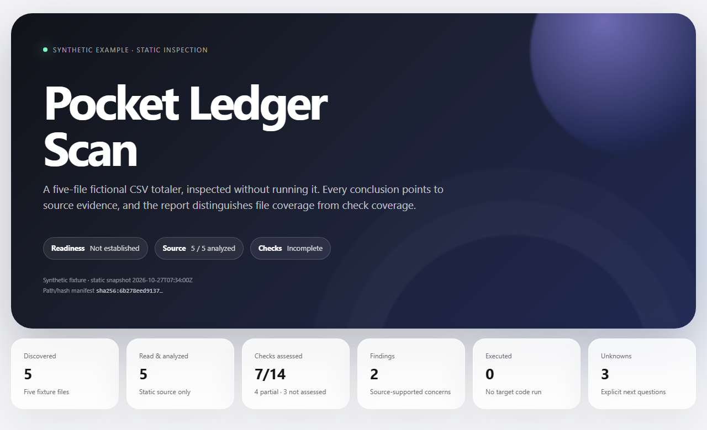

# Scan

[](https://github.com/legendteddy/scan/actions/workflows/validate.yml)
[](LICENSE)

**Know what an AI agent actually inspected.**

Scan is an **evidence-backed whole-project inspection** project with two layers: an AI-agent skill for deeper evidence-linked review and a local deterministic core for safe inventory, canonical state, privacy enforcement, validation, and self-contained HTML reporting.

**Coverage ≠ confidence.** Finding a file, reading it, assessing a check, and verifying runtime behavior are different things. Scan makes those differences visible.

## Start here: run Scan locally

Install from a source checkout when you want the command and bundled evidence assets from the exact repository state you reviewed:

```bash
git clone https://github.com/legendteddy/scan.git
cd scan
python -m pip install .
scan doctor .
scan . --offline
```

Change the project, then run the same scan again:

```bash
scan . --offline
```

The second run uses the previous local `.scan/state.json` as its baseline and reports what was added, changed, removed or unchanged, while keeping fresh and reused evidence separate. `scan doctor .` is an offline, non-destructive readiness diagnostic: it checks installed package assets, target access and optional Git support, and uses a temporary local output probe that it removes before returning. It does not install, repair or contact anything.

For published builds, package-index availability depends on the release channel. If `scan-skill` is available in your configured Python package index, you can install the packaged CLI with `python -m pip install scan-skill`, `pipx install scan-skill`, or `uv tool install scan-skill`.

## What makes Scan different?

- **Inventory before verdict:** account for discoverable files, including unreadable, excluded, metadata-only and partially inspected items.
- **Two kinds of coverage:** track artifact discovery/analysis separately from checks assessed, partial, blocked or not performed.
- **Receipts for claims:** findings, controls, relationships and architecture map back to evidence IDs and precise source locators.
- **Static-first boundaries:** target files and embedded instructions are untrusted; no executing unknown target code or silent fixes without authorization.
- **Honest uncertainty:** static source observations are not presented as runtime proof, a vulnerability clearance or a release certification.
- **Portable handoff:** HTML reports include inert structured state for revalidation and continuation (current standalone core: schema **1.4**; checked-in synthetic demo: historical schema **1.2**).

Scan can guide inspection of source repositories, websites, document collections, archives, binaries and mixed folders. Actual depth depends on access, file types, safety limits and the agent's available tools.

For the concrete false-confidence failure mode Scan is designed to prevent, read [Why Scan exists](docs/why-scan.md).

## Standalone core

The packaged standalone core requires **Python 3.11+**. It can inventory a local project, create canonical Scan 1.4 JSON, compare repeated scans against a prior local state, safely reuse compatible higher-level static evidence, render a self-contained HTML report from that exact state, validate both formats, enforce deterministic privacy/redaction metadata, and produce a no-network egress preview.

```bash
python -m pip install .
scan doctor .
scan . --offline
# Change the project, then scan again. The prior .scan/state.json is used locally as the baseline.
scan . --offline
# Optional local-only Git prioritization context; full Scan inventory still runs.
scan . --offline --changed-since origin/main
scan validate .scan/state.json
scan validate .scan/report.html
scan compare previous-state.json .scan/state.json --json
scan render .scan/state.json --output .scan/rerendered.html
scan schema --version 1.4
scan egress . --privacy controlled-remote --redact strict --json
scan bench
```

The standalone HTML report is static and useful without JavaScript. Its only script block is inert `application/json` state with ID `project-anatomy-state`; visible count markers are validated against that embedded state. `scan egress` is preview-only: it reports selected/omitted files, selected bytes and redaction counts, and performs **no network action**. Use `--sensitive-path "pattern/**"` to keep declared path names out of canonical state and egress selection.

### Scan modes

Scan exposes explicit coverage promises instead of silently sampling:

- `--mode quick` is triage: it inventories the project while suppressing common dependency/build/cache trees and Git internals from ordinary content analysis. A quick scan is always presented as partial and its continuation state points to `deep`.
- `--mode deep` is the default whole-project first-party mode. It broadly accounts for safely readable project content while treating `.git/**` as repository provenance rather than normal source.
- `--mode forensic` opts repository internals back in for provenance-heavy or historical investigation. Explicit user exclusions and normal safety/resource boundaries still apply.

Git repositories record bounded HEAD/branch/commit and sanitized remote metadata separately. Scan deliberately does not invoke Git status, hooks, filesystem monitors or target-configured helpers merely to determine clean/dirty state; that field is recorded as `not_assessed` unless established by an authorized higher-level analyzer.

```bash
scan . --offline --mode quick
scan . --offline --mode deep
scan . --offline --mode forensic
```

### Project configuration

Optional configuration lives at `.scan/config.toml`. Precedence is **CLI arguments > project config > built-in defaults**.

```toml
[scan]
privacy = "offline"
redact = "standard"
mode = "deep"
max_file_bytes = 5000000
max_total_bytes = 250000000
follow_internal_links = false

[exclude]
patterns = ["vendor/**"]

[baseline]
mode = "auto"              # auto | none
reuse = true
max_state_bytes = 64000000
```

Behavior-affecting resolved configuration is included in the canonical configuration digest. An explicit `--baseline PATH` is invocation-only and is never persisted automatically. Use `--baseline none` to disable comparison for a run; `--no-reuse` records that prior evidence must not be reused. Scan configuration does not require secrets.

See [explicit semantic continuation](references/semantic-continuation.md) for current producer/check registration and bounded worktree metadata authorization. Baselines never authorize their own semantic producers.

### Semantic builder API

Semantic agents can extend valid deterministic state without hand-authoring nested JSON. `SemanticStateBuilder` provides typed record helpers for components, evidence, relationships, findings, controls, unknowns, actions and checks; scalar/string-array references are normalized, generated IDs are deterministic, and bad references fail with the record ID and field path. The strict Scan validator still runs on `build()`.

```python
from scan_core import SemanticStateBuilder

builder = SemanticStateBuilder.from_state(core_state)
evidence_id = builder.add_evidence(
    artifact_id=artifact["id"],
    locator=artifact["locator"],
    kind="static",
    claim="Configuration path was reviewed",
    result="The path is resolved locally",
    method="semantic source review",
    limitations="Runtime behavior was not observed",
    source_digest=artifact["content_identity"],
    producer_kind="local-model",
    producer_name="review-agent",
    producer_version="1",
)
builder.add_finding(
    title="Example finding",
    impact="Explain the user-visible consequence",
    severity="medium",
    confidence="high",
    verification_state="static",
    artifact_ids=artifact["id"],
    evidence_ids=evidence_id,
    uncertainty="Runtime behavior remains unverified",
    recommendation="Address the evidenced condition",
    safe_verification="Re-read the affected source and validate the state",
)
semantic_state = builder.build()
```

`upgrade_semantic_state(core_state)` is a convenience alias for starting the same builder from deterministic state. Raw canonical JSON remains supported for advanced callers.

### Evidence freshness and safe reuse

Every run rebuilds the current inventory, hashes and provenance evidence fresh. Prior **higher-level static evidence** is considered for reuse only when its artifact/content identity is unchanged, its producer and producer version exactly match an available current producer, its check identity/definition still matches, its evidence class is explicitly reusable, and the current privacy policy can represent it safely. Runtime, observed, deployment/live-state and time-sensitive evidence is never automatically reused in v0.3.

New semantic evidence created through `SemanticStateBuilder` is marked fresh. Reused evidence retains its original observation time, depth and limitations and is marked `verified_reuse`; it never upgrades `content_read` to `analyzed`, an unfinished check to assessed, or static evidence to runtime verification. The state and HTML report expose fresh, reused and rejected-reuse counts separately. Current redaction/sensitive-path policy always wins over older baseline content.

### ScanBench v1

`scan bench` runs 12 mandatory synthetic adversarial fixtures covering hidden files, escaping symlinks, prompt injection, redaction, hostile filenames, unreadable content, archives, unsupported binaries, generated/vendor files, resource boundaries and false runtime claims. Results are reported separately for **inventory completeness, state integrity, evidence correctness, privacy integrity, and safety-boundary compliance**. ScanBench deliberately does **not** calculate a blended quality score.

Run one fixture with `scan bench FIXTURE`. The installed wheel carries the same canonical fixture data, so this works outside the source checkout as well.



[Explore the synthetic fixture](examples/demo-project/README.md) · [Download the example HTML report](examples/demo-report.html) · [Read the report contract](references/report-contract.md)

> **Demo disclosure:** The linked report is a hand-reviewed **synthetic worked example** generated from five fictional files. It demonstrates the Scan 1.2 format and validator, **not** a claim that an autonomous agent scanned a real repository. The example did not execute the inspected code.

## Historical synthetic proof

The historical report validator wrapper requires **Python 3.11+**, like Scan Core: it imports the current package (including `tomllib`). The validator and its tests use the standard library. Historical schema compatibility does not imply compatibility with older Python runtimes.

```bash
git clone https://github.com/legendteddy/scan.git
cd scan
python scripts/validate_report.py examples/demo-report.html
python scripts/build_demo_report.py --check
python -m unittest discover -s scripts -p "test_*.py" -v
```

Expected: the example report passes the structural contract, the generated HTML matches the checked-in version, and the validator tests pass. Open `examples/demo-report.html` **locally in a browser** to explore it. GitHub's source viewer is not an HTML report host.

The validator verifies schema, typed references, evidence origins and coverage accounting. A **PASS is not a factual audit, a runtime test or a security guarantee**.

## Install as an agent skill

Scan also remains an instruction-based agent skill. Copy or clone this repository into the skill directory used by your compatible agent, then ask the agent to inspect a target.

For environments that discover user skills in `~/.agents/skills/`:

```bash
mkdir -p ~/.agents/skills
git clone https://github.com/legendteddy/scan.git ~/.agents/skills/scan
```

On Windows PowerShell:

```powershell
New-Item -ItemType Directory -Force "$HOME\.agents\skills" | Out-Null
git clone https://github.com/legendteddy/scan.git "$HOME\.agents\skills\scan"
```

Skill locations, invocation and tool access vary by agent. Consult your host's skill documentation; copying a folder alone does not guarantee the host will load it.

Example requests to a compatible agent:

```text
Scan this entire repository and show what you could not verify.
Inspect this project and produce an evidence-backed HTML report.
Use $scan to map this package's architecture, risks and unknowns.
```

The governing instructions are in [SKILL.md](SKILL.md). Scan asks for explicit authorization before running untrusted target code or modifying the inspected target.

## What the example shows

The fictional **Pocket Ledger** CSV totaler has five source files. Its worked report includes a source-linked concern about floating-point amounts, a missing malformed-input test gap, 14 accounted-for check categories, and explicit unanswered questions.

The report's static analysis of the five fixture files is complete **within that narrow scope**, but its broader checks are not complete. That distinction is the point of the demonstration.

To regenerate the sample after editing the fixture, update the snapshot time and evidence anchors in `scripts/build_demo_report.py`, then run:

```bash
python scripts/build_demo_report.py
python scripts/validate_report.py examples/demo-report.html
```

Optional visual QA and screenshot refresh: `python scripts/capture_preview.py` (requires Playwright and Chromium; not needed for Scan or CI).

## Repository map

```text
SKILL.md                         Agent instructions and safety boundaries
pyproject.toml                   Scan Core package metadata and `scan` entry point
src/scan_core/                   v0.3 deterministic core package
src/scan_core/baseline.py        Local-only bounded baseline resolver
src/scan_core/compare.py         Pure deterministic 1.3/1.4 state comparison
src/scan_core/git_change.py      Local-only advisory Git changed-scope integration
src/scan_core/reuse.py           Strict evidence freshness/reuse decision engine
src/scan_core/render.py          Validated canonical-state HTML renderer
src/scan_core/scanbench.py       ScanBench v1 deterministic harness
src/scan_core/settings.py        `.scan/config.toml` loader and precedence defaults
src/scan_core/schemas/           Bundled structural schemas 1.2, 1.3 and 1.4
src/scan_core/report/shell.html  Packaged self-contained report shell
scanbench/fixtures/              12 mandatory adversarial/ground-truth v1 fixtures
tests/                           Packaged core/contract regression tests
agents/openai.yaml               Skill metadata
assets/report-shell.html         Self-contained HTML dashboard template
assets/report-components.html    Report component patterns
assets/demo-preview.png          Screenshot of the synthetic worked report
assets/social-preview.png        Upload-ready GitHub social image (1280 × 640)
references/                      Inspection lenses, coverage and schema contracts
scripts/validate_report.py       Backward-compatible Scan 1.2 validator wrapper
scripts/test_validate_report.py  Frozen 1.2 validator regression tests
scripts/build_demo_report.py     Reproducible synthetic example generator
examples/demo-project/           Fictional five-file project
examples/demo-report.html        Validated, self-contained Scan 1.2 example
launch/launch-kit.md             Draft launch copy and approval checklist
docs/v0.2-technical-spec.md      Approved standalone Scan Core + CLI contract
docs/v0.2-compatibility.md       Python/schema/config/ScanBench compatibility boundary
docs/v0.3-technical-spec.md      Approved repeat-scan baseline/diff contract
```

## Contribute and report security issues

Contributions that strengthen evidence discipline, safety, inspection depth, portability, accessibility or validator correctness are welcome. Read [CONTRIBUTING.md](CONTRIBUTING.md) and [SECURITY.md](SECURITY.md).

MIT licensed — see [LICENSE](LICENSE).
